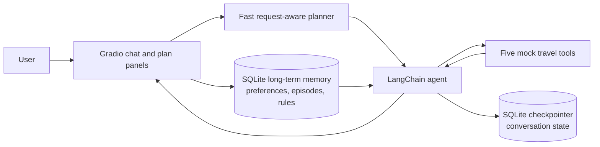

# Travel Agent with Memory

A small Gradio travel assistant built with LangChain and LangGraph's checkpointing concepts. Its travel tools return fictional data. It demonstrates conversation history, persistent preferences, visible planning, and tool execution.

## Project layout

```text
.
├── app.py                  # Run the Gradio application
├── setup.bat               # One-time Windows environment setup
├── run.bat                 # Start the app without reinstalling dependencies
├── demo.py                 # Two-process persistence demonstration
├── .env                    # Local model key/settings (ignored by Git)
├── .env.example            # Safe template for creating a local .env
├── requirements.txt
├── docs/
│   ├── PROJECT_GUIDE.md      # Full project, memory, demo, and viva guide
│   └── MEMORY_PRESENTATION.md # Short five-slide presentation outline
├── travel_agent/
│   ├── config.py            # Model and SQLite paths
│   ├── orchestration/
│   │   ├── agent.py          # LangChain agent and execution flow
│   │   └── planning.py       # Fast request-aware visible plan
│   ├── memory/
│   │   └── store.py          # Persistent long-term memory
│   ├── tools/
│   │   └── travel.py         # Five fictional travel tools
│   └── interface/
│       └── gradio_app.py     # Gradio interface
└── notebooks/
    └── original_task_ai_agent.ipynb  # Original notebook, retained as a reference
```

Each package has one responsibility: `orchestration` plans and runs the LangChain agent, `memory` owns durable user data, `tools` contains the mock integrations, and `interface` handles Gradio presentation. `config.py` holds shared runtime settings.

## Assignment deliverables

- **Application and source:** `app.py` and the modular `travel_agent/` package.
- **Short presentation:** [`docs/MEMORY_PRESENTATION.md`](docs/MEMORY_PRESENTATION.md).
- **Architecture diagram:** Mermaid diagram below and in [`docs/PROJECT_GUIDE.md`](docs/PROJECT_GUIDE.md).
- **Persistent-memory demonstration:** run `python demo.py` to save preferences in one process and use them in a second process.
- **Detailed project explanation and viva preparation:** [`docs/PROJECT_GUIDE.md`](docs/PROJECT_GUIDE.md).

## Run the application

Use Python 3.12 for this demo. Python 3.14 currently triggers a Pydantic v1 compatibility warning in this dependency stack. On Windows, run the one-time setup command:

```powershell
.\setup.bat
```

This creates `.venv` and installs the packages once. It does not need to be run again for ordinary launches.

Create the project-root `.env` from the safe template, then replace its placeholder with your Gemini API key:

```dotenv
GOOGLE_API_KEY=your-real-gemini-api-key
TRAVEL_AGENT_MODEL=google_genai:gemini-3.5-flash-lite
```

In PowerShell, the copy command is `Copy-Item .env.example .env`.

Start or restart the app whenever you want with:

```powershell
.\run.bat
```

The app loads simple `KEY=value` entries from `.env` using the Python standard library; no extra dotenv package is needed. `.env` is ignored by Git so the API key stays local. `run.bat` calls the virtual environment's Python directly, so PowerShell script activation policies do not need to be changed. On macOS or Linux, create the environment and install requirements once, then launch `python app.py` from the activated environment. In VS Code, select `.venv\Scripts\python.exe` as the Windows workspace interpreter.

If `.venv` already exists and dependencies are installed, do not rerun setup; add the key to `.env` and start with `run.bat`.

If a model request fails with `504 DEADLINE_EXCEEDED`, the network may be reachable while that model's backend is timing out. This project was verified with `google_genai:gemini-3.5-flash-lite`; Gemini 3.8 Flash returned repeated 504s during verification. To try 3.8 again later, change `TRAVEL_AGENT_MODEL` in `.env` to `google_genai:gemini-3.8-flash`. The app also removes an inherited proxy setting only when it points to the known unusable `localhost:9`/`127.0.0.1:9` endpoint; it does not change Windows proxy settings.

By default, the app writes `data/long_term_memory.sqlite` and `data/conversation_checkpoints.sqlite`. Set `TRAVEL_AGENT_DATA_DIR` to a durable directory when running in an environment whose working directory is temporary. The model can be changed with `TRAVEL_AGENT_MODEL` in `.env`. Gemini 3.5 Flash-Lite is the default because it was live-verified with this project and supports both tool calling and structured output. If Gemini 3.8 Flash is responding normally for your account, set the value to `google_genai:gemini-3.8-flash`.

## Demo: preference memory across a process restart

Run:

```bash
.\.venv\Scripts\python.exe demo.py
```

The demo starts two separate Python processes using the same SQLite files. The first process stores museum, cuisine, early-morning, and hotel-budget preferences. It exits. The second process starts a new conversation and plans Florence using those saved preferences. The hotel and attraction tools apply the budget and activity constraints in code, so the demo does not depend only on the model remembering to filter results.

To run each process manually, use `.\.venv\Scripts\python.exe demo.py remember`, then `.\.venv\Scripts\python.exe demo.py plan`. Both commands must use the same `TRAVEL_AGENT_DATA_DIR` if you changed the default data location.

## Memory comparison: legacy LangChain patterns and LangGraph

### Older LangChain memory patterns

The classes below are **legacy patterns**. They managed conversation context inside chains, often by loading transcript text into a prompt. They are useful to understand historically, but they are not the recommended foundation for new agent memory. In current LangChain releases, these APIs are in the `langchain-classic` package.

| Legacy pattern | What it kept | Main trade-off |
|---|---|---|
| `ConversationBufferMemory` | The whole conversation transcript | Simple, but history grows without a bound and can exceed the model's context window. |
| `ConversationBufferWindowMemory` | The latest `k` turns | Limits prompt size, but older details disappear abruptly. |
| `ConversationSummaryMemory` | A model-written summary of the conversation | Saves tokens, but summaries can omit details and require summary updates. |
| `ConversationTokenBufferMemory` | Recent messages up to a token limit | Controls context size, but truncation can remove useful older information. |
| `ConversationSummaryBufferMemory` | A recent message buffer plus a summary of older messages | Balances detail and size, with added summarization behavior and possible information loss. |
| `VectorStoreRetrieverMemory` | Retrieved text chunks similar to the current query | Finds relevant past facts, but needs embeddings/vector storage and retrieval can miss or mis-rank facts. |
| Entity or knowledge-graph memory | Extracted entities and related facts | Can organize relationships, but extraction and graph maintenance add complexity. |

Small examples of the older interfaces (shown for comparison; they are not used by this application):

```python
from langchain_classic.memory import ConversationBufferMemory

memory = ConversationBufferMemory()
memory.save_context({"input": "I like museums"}, {"output": "I'll remember that."})
prompt_values = memory.load_memory_variables({})
```

```python
from langchain_classic.memory import ConversationBufferWindowMemory

recent_only = ConversationBufferWindowMemory(k=2)  # keep a small recent window
```

Summary/token-buffer variants replace the raw transcript with a summary or constrain the transcript by a token budget. Retriever memory stores text separately and retrieves relevant items for a prompt; it is not the same as saving the current thread state.

### LangGraph-era memory: separate state from durable knowledge

The newer approach separates two jobs:

- **Short-term conversation memory** is the graph's conversation state. A checkpointer saves and reloads that state for a conversation identifier. This app uses `SqliteSaver`; the same thread ID must be supplied to resume it after a process restart. The current UI creates an internal ID for each browser session and has no saved-thread picker.
- **Long-term memory** is user knowledge that can be reused across conversations. It has its own storage key/namespace and lifecycle. This app uses SQLite tables keyed by `user_id`, rather than treating the entire transcript as the user's memory.

An illustrative short-term checkpointer pattern:

```python
from langchain.agents import create_agent
from langgraph.checkpoint.sqlite import SqliteSaver

checkpointer = SqliteSaver(sqlite_connection)
agent = create_agent(model, tools, checkpointer=checkpointer)
config = {"configurable": {"thread_id": "conversation-123"}}
agent.invoke({"messages": [("user", "Plan a trip")]}, config)
```

For systems that use LangGraph's long-term store API, records are organized by namespace and key:

```python
namespace = ("users", "user-42", "preferences")
store.put(namespace, "cuisine", {"likes": "Italian"})
preference = store.get(namespace, "cuisine")
```

This project uses a small SQLite implementation for the same durable-memory role; the LangGraph checkpointer is used for short-term graph state. It does not require a vector database because the demo retrieves a small, structured set of user preferences directly.

### Long-term memory categories in this demo

These are useful **design categories**, not separate LangGraph storage engines:

- **Semantic memory**: facts and preferences that are intended to remain useful, such as “likes museums,” “prefers Italian food,” and “hotel budget is 100–150 EUR per night.”
- **Episodic memory**: short summaries of prior planning sessions, such as a destination and choices made.
- **Procedural memory**: durable instructions for how the assistant should behave, such as “present itineraries day by day.”

The app stores these categories in SQLite and injects the relevant records into the agent's prompt. A larger system could use LangGraph's persistent `Store` API or a vector-backed store for semantic search over a large collection.

### Architecture



## How the plan and tools work

The request-aware planner creates a visible plan locally before model calls begin, so planning does not wait on a separate model round-trip. The activity trace then shows preference extraction, memory loading, model/tool decisions, tool completions, and answer assembly. The trace reports observable actions; it does not expose private chain-of-thought. If the agent fails to run a planned tool, the plan marks it as skipped and flags the final step for attention instead of claiming the plan completed successfully. Tool logs show arguments and mock JSON results.

Saved preferences are also applied deterministically by the tools: hotel results are capped by the saved budget, museum interests filter attraction results, early starts are removed when the user avoids early-morning activities, and a saved Italian-food preference filters restaurant results. The agent is prompted to explain which preferences it used.

## Scope and limitations

- Search data is fixed fictional JSON; no bookings or real API calls occur.
- Preference extraction uses the configured language model. The database stores the extracted text; the demo's filters handle common museum, Italian-food, early-morning, and numeric EUR budget examples.
- SQLite persistence depends on the database directory being retained by the runtime.
- Conversation checkpoints grow over time; this small assignment demo does not yet add message trimming or summarization middleware.
