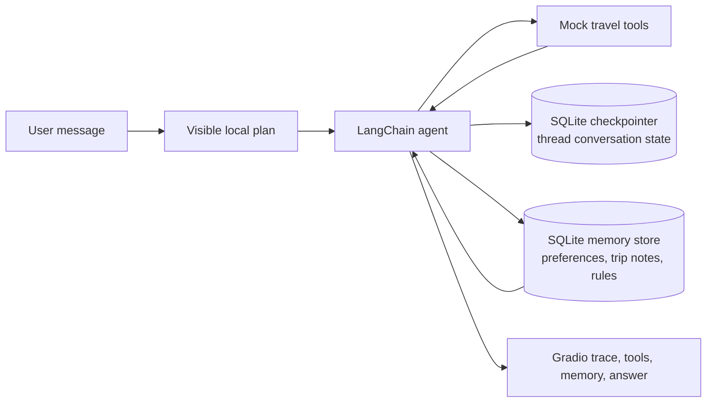

# Short Presentation: Memory in LangChain and LangGraph

Use these five slides for a short class presentation. Each slide includes the points to show and a simple speaker note.

## Slide 1 — What does “memory” mean in an AI agent?

- A language model does not automatically remember earlier messages forever.
- An application supplies relevant past information to the model when it needs it.
- Two useful questions are: **What should be remembered?** and **For how long?**
- This project demonstrates conversation state and durable travel preferences.

**Say:** “Memory is application-managed context. The model uses information that the application stores and provides; it does not independently keep this project’s SQLite records.”

## Slide 2 — Older LangChain memory patterns

These are **legacy patterns** from older LangChain chain APIs. They are helpful concepts to learn, but the project does not use them for its agent memory.

| Pattern | How it works | Main trade-off |
|---|---|---|
| `ConversationBufferMemory` | Stores the full transcript. | Grows without a bound. |
| `ConversationBufferWindowMemory` | Keeps only the latest *k* turns. | Older information drops out. |
| `ConversationSummaryMemory` | Summarizes conversation history. | Summaries may omit details. |
| Token-buffer memory | Keeps history up to a token limit. | Old messages are removed at the limit. |
| Summary-buffer memory | Keeps recent messages and summarizes older ones. | More moving parts; summary quality matters. |
| Vector/retriever memory | Retrieves past text similar to the current query. | Needs embeddings and retrieval; matches can be missed. |
| Entity/knowledge-graph memory | Stores extracted entities and relationships. | Extraction and graph maintenance add complexity. |

Legacy example:

```python
from langchain_classic.memory import ConversationBufferMemory

memory = ConversationBufferMemory()
memory.save_context(
    {"input": "I like museums"},
    {"output": "I will keep that in mind."},
)
context = memory.load_memory_variables({})
```

**Say:** “These patterns mainly describe how conversation context gets loaded into a chain. A transcript or summary is not automatically the same as a durable user profile.”

## Slide 3 — The newer LangGraph memory model

LangGraph encourages separating conversation state from durable knowledge:

- **Short-term memory:** current thread state, often saved with a checkpointer.
- **Long-term memory:** records shared across conversations, often saved in a persistent store.
- **Semantic memory:** stable facts, such as preferences.
- **Episodic memory:** notes about events or past tasks.
- **Procedural memory:** reusable instructions about how to behave.

Short-term checkpointer example:

```python
from langchain.agents import create_agent
from langgraph.checkpoint.sqlite import SqliteSaver

checkpointer = SqliteSaver(sqlite_connection)
agent = create_agent(model, tools, checkpointer=checkpointer)
config = {"configurable": {"thread_id": "conversation-123"}}
agent.invoke({"messages": [("user", "Plan a trip")]}, config)
```

**Say:** “The thread ID tells the checkpointer which conversation to load. Long-term user knowledge has a separate namespace and lifecycle. Semantic, episodic, and procedural are information categories, not three special databases.”

## Slide 4 — How this assignment applies memory



- The checkpointer stores conversation state by thread ID.
- A separate SQLite memory store holds preferences, trip notes, and behavior rules.
- The tools apply the museum, Italian-food, early-morning, and hotel-budget preferences to fictional results.
- No real flights, hotels, restaurants, or reservations are involved.

Long-term memory example from this project:

```python
memory.save_preference("demo_user", "likes", "museums")
saved_profile = memory.get_all("demo_user")
```

**Say:** “We use SQLite because the assignment profile is small and structured. We do not need vector search for four simple preference types.”

## Slide 5 — Persistent-memory demo and takeaway

1. Conversation 1: “I like museums and Italian food, avoid early mornings, and prefer hotels around 100–150 EUR per night.”
2. Stop and restart the app, or run `.\.venv\Scripts\python.exe demo.py`, which uses two separate Python processes.
3. Conversation 2: “Plan me a weekend in Florence.”
4. Show the loaded preferences, visible plan, tool results, and filtered recommendations.

**Takeaway:** “Conversation history and long-term user knowledge are different. A checkpointer saves thread state; a separate persistent store saves knowledge that can be reused in another conversation.”

The automated two-process demonstration is implemented in [`demo.py`](../demo.py). See the [full project guide](PROJECT_GUIDE.md) for setup, source-file explanations, limitations, and likely viva questions.
