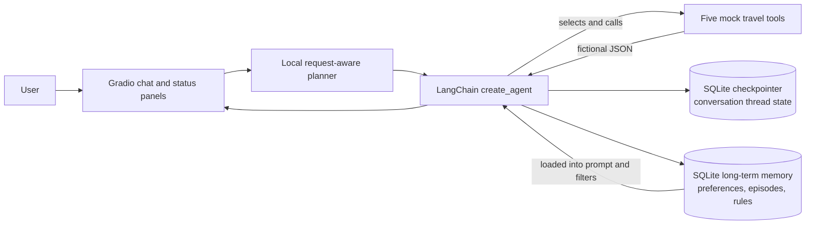

# Project Guide: Travel Agent with Memory

This guide explains the assignment, the application, its memory, how to run the demo, and how to explain the design in a presentation or viva. It uses plain language first, then points to the source code for the details.

## 1. The project in one minute

This is a small travel-planning assistant built with **LangChain**, **LangGraph checkpointing**, **Gradio**, and **SQLite**. It accepts a chat message, shows a visible plan, asks a language model to choose among five fictional travel tools, and displays the tool results and final response.

It demonstrates two kinds of memory:

1. **Conversation memory:** LangGraph's SQLite checkpointer saves the messages and agent state for a conversation thread.
2. **Long-term memory:** a separate SQLite database saves explicit travel preferences, short notes about completed trip requests, and assistant behavior rules. These records can be used in later conversations and remain after the app restarts, as long as the database file is kept.

For the assignment demo, share preferences first, then ask for a trip. Example: “I like museums and Italian food, and I avoid early morning activities. My hotel budget is 100–150 EUR per night.” Later ask: “Plan me a weekend in Florence.” The saved preferences are loaded automatically and relevant tools filter their fictional results.

## 2. Assignment deliverables map

| Requirement | Where to find it |
|---|---|
| Gradio application | [`app.py`](../app.py) and [`travel_agent/interface/gradio_app.py`](../travel_agent/interface/gradio_app.py) |
| LangChain agent and orchestration | [`travel_agent/orchestration/agent.py`](../travel_agent/orchestration/agent.py) |
| Persistent preferences, episodes, and rules | [`travel_agent/memory/store.py`](../travel_agent/memory/store.py) |
| Five mock tools | [`travel_agent/tools/travel.py`](../travel_agent/tools/travel.py) |
| Visible plan and progress | [`travel_agent/orchestration/planning.py`](../travel_agent/orchestration/planning.py) and the Gradio interface |
| Short memory presentation | [`MEMORY_PRESENTATION.md`](MEMORY_PRESENTATION.md) |
| Architecture diagram | Section 4 of this guide and the README |
| Repeatable persistence demo across separate processes | [`demo.py`](../demo.py) |
| Memory comparison, code examples, and run instructions | [`README.md`](../README.md) |
| This full project explanation and oral Q&A | This file |

## 3. How the application works

### The request path

1. The user enters a message in the Gradio chat.
2. The app assigns each browser session a conversation thread ID. The ID is internal; the UI does not ask for or display a user ID.
3. A small local planner selects the steps that fit the request and shows the plan immediately. For a trip request, it selects flights, hotels, attractions, restaurants, and weather.
4. If the message appears to contain a durable preference, the configured language model extracts it into a structured schema. The application saves extracted items to SQLite.
5. The app reads the saved profile and adds it to the agent's instructions.
6. A LangChain agent created with `create_agent` chooses tools and supplies their arguments. Each tool returns fictional JSON data.
7. Tools apply selected preferences as code-level filters where supported. For example, hotel results are capped by a saved budget; attraction results can focus on museums and remove early starts; restaurant results can focus on Italian food.
8. The Gradio panels update with the plan, activity trace, tool arguments/results, saved memory, and final answer.
9. A short note about the trip request and the tools used is saved as an episode.

The activity trace reports actions the program can observe, such as “memory loaded” or “tool completed.” It is not a display of the model's private chain-of-thought.

### Modules and responsibilities

| File or folder | Responsibility |
|---|---|
| [`app.py`](../app.py) | Starts the Gradio application. It also gives a clear message if Python 3.14+ is used with this dependency stack. |
| [`travel_agent/config.py`](../travel_agent/config.py) | Loads local `.env` settings, configures the model and SQLite paths, and removes the known unusable `localhost:9` proxy setting from this process only. |
| [`travel_agent/interface/gradio_app.py`](../travel_agent/interface/gradio_app.py) | Builds the chat and four information panels: plan, activity trace, tool results, and memory in use. |
| [`travel_agent/orchestration/planning.py`](../travel_agent/orchestration/planning.py) | Creates a fast, deterministic visible plan from the user message. It does not call the language model to plan. |
| [`travel_agent/orchestration/agent.py`](../travel_agent/orchestration/agent.py) | Extracts preferences, builds the prompt, creates the LangChain agent, streams observable steps, records tool results, and writes trip episodes. |
| [`travel_agent/tools/travel.py`](../travel_agent/tools/travel.py) | Defines five mock tools: flights, hotels, attractions, restaurants, and weather. |
| [`travel_agent/memory/store.py`](../travel_agent/memory/store.py) | Stores preferences, episodes, and rules in SQLite and provides helper functions used by the tools. |
| [`demo.py`](../demo.py) | Demonstrates persistent preference memory by starting two separate Python processes. |
| [`setup.bat`](../setup.bat), [`run.bat`](../run.bat) | Install dependencies into a virtual environment once, then start the app without reinstalling every time. |

### Important orchestration functions

| Function or type | What it does |
|---|---|
| `Preference` and `ExtractedMemory` | Pydantic schemas that constrain preference extraction to known categories and predictable fields. |
| `create_runtime()` | Checks that the API key exists, creates the configured chat model, opens the memory store, and opens the SQLite checkpointer connection. |
| `_extract_and_save(...)` | Calls the model's structured-output interface, then writes each extracted preference or style rule to SQLite. |
| `_system_prompt(...)` | Reads semantic, episodic, and procedural memory and builds the instructions for the agent. |
| `run_agent(...)` | Coordinates visible planning, preference extraction, memory loading, agent streaming, tool logs, failure statuses, and episode saving. It yields snapshots so Gradio can update while work proceeds. |
| `conversation_messages(...)` | Reads user and assistant messages from a saved checkpointer thread for the memory panel. |
| `build_tools(...)` | Creates tools bound to the current local profile, so each tool can apply its relevant saved preferences. |

`stream_mode="updates"` yields agent state changes such as model tool calls and tool results. The application converts these updates into human-readable activity and progress; it does not show hidden model reasoning.

### SQLite records

The long-term memory database contains three small tables:

| Table | Main fields | Purpose |
|---|---|---|
| `preferences` | `user_id`, `category`, `value`, `updated_at` | Stores extracted durable profile values. A user can have multiple likes or avoids; a new budget replaces the older budget. |
| `episodes` | `id`, `user_id`, `summary`, `created_at` | Stores a short note after a trip request has used tools. |
| `procedures` | `user_id`, `rule` | Stores custom assistant behavior rules. Built-in default rules are defined in Python and added to the prompt when memory is loaded. |

The checkpointer has its own schema, maintained by LangGraph's SQLite saver. Application code should use the saver API rather than modifying those tables directly.

## 4. Architecture



The diagram shows two separate SQLite roles. The **checkpointer** stores the state of a conversation thread. The **memory database** stores profile information that the application explicitly extracts and can reuse in another conversation. The current project uses a small custom SQLite `MemoryStore` for long-term information; it does not claim to use LangGraph's optional long-term `Store` API.

## 5. Memory concepts

### Older LangChain memory patterns

The following are **legacy memory patterns**. They are useful to understand because they appeared in older LangChain chain tutorials and APIs. Current LangChain separates many of these older APIs into the `langchain-classic` package. They are not used as the agent's memory implementation in this project.

| Pattern | Plain-language description | Common limitation |
|---|---|---|
| `ConversationBufferMemory` | Keep the complete conversation transcript. | The transcript keeps growing and can use too many tokens. |
| `ConversationBufferWindowMemory` | Keep only the most recent *k* turns. | Older facts disappear when they fall outside the window. |
| `ConversationSummaryMemory` | Ask a model to summarize the conversation so far. | A summary can omit or distort a detail and must be updated. |
| `ConversationTokenBufferMemory` | Keep messages up to a token budget, dropping older content as needed. | An important fact can be removed when the limit is reached. |
| `ConversationSummaryBufferMemory` | Keep recent messages and summarize older ones. | More flexible, but summary quality and token management add complexity. |
| `VectorStoreRetrieverMemory` | Embed past text and retrieve items that seem relevant to the new message. | Requires embedding and vector storage; retrieval may miss or mis-rank a fact. |
| Entity or knowledge-graph memory | Extract people, places, and relationships into structured records. | Requires reliable extraction and graph maintenance. |

The key difference is that these patterns mostly describe **how to carry context into a prompt**. A transcript or summary is not automatically the same thing as durable, structured user preferences.

### Newer LangGraph memory approach

LangGraph makes a useful distinction between **thread state** and **long-term records**:

- **Short-term conversation memory (thread state):** messages and other graph state are saved by a checkpointer. A `thread_id` selects which conversation state to reload. This project uses `SqliteSaver`.
- **Long-term memory:** facts or instructions are saved separately so they can be reused across threads. LangGraph offers a persistent Store API for this role. This project uses its own small SQLite tables instead, which keeps the assignment easy to inspect and avoids another service.

For a saved checkpointer thread to be resumed after an app restart, the same `thread_id` must be supplied again. The current Gradio page creates a fresh internal thread ID for a new browser session; it does not provide a conversation-history picker. The assignment's restart-survival demonstration is the long-term preference memory, which is stored separately and is reloaded by a later app process.

### Semantic, episodic, and procedural memory

These names describe **kinds of information**. They are not three separate databases or built-in LangGraph memory classes.

| Category | What it means | Example in this project |
|---|---|---|
| Semantic | Stable facts about the user or world. | “Likes museums,” “likes Italian food,” “avoids early mornings,” “hotel budget is 100–150 EUR per night.” |
| Episodic | A short record of something that happened. | “Request: Plan a weekend in Florence. Tools used: flights, hotels, attractions…” |
| Procedural | A reusable instruction about how the assistant should behave. | “Present itineraries day by day with approximate times.” |

### How preferences are extracted and used

The application first checks for common preference phrases. If it sees a likely preference message, it asks the model for structured output matching a Pydantic schema. Each extracted item has a category (`likes`, `avoids`, `budget`, or `other`) and a value. The application stores the result in SQLite.

On a later request, the stored values are read and included in the agent's system prompt. Tools also read selected memory records directly, so a model answer alone is not responsible for applying every filter:

- **Hotel budget:** the tool finds the largest amount in the saved budget string and uses it as a hard per-night cap. A range such as `100-150 EUR per night` therefore gives a cap of 150 EUR.
- **Museums:** a saved museum interest filters attractions to entries whose type includes “museum.”
- **Early mornings:** saved avoidance of early activities removes attraction entries before 09:00.
- **Italian food:** a saved Italian preference filters the restaurant list to Italian options.

These are intentionally small assignment rules, not a general natural-language constraint engine. The project stores the extracted preference text without an embedding model or vector search.

## 6. Planning and tools

The visible plan is created locally before any model call. This means the user can see the expected steps without waiting for a separate LLM planning response. It is a request-aware checklist, not a claim that the model has privately reasoned through the task.

For a trip request, the plan normally contains:

1. Read saved preferences.
2. Search flights.
3. Search hotels.
4. Find attractions.
5. Search restaurants.
6. Check weather.
7. Prepare the answer.

The agent then chooses tools. The interface marks tools as pending, running, completed, skipped, or failed. If an expected tool was not called, its step is shown as skipped and the final step needs attention. This makes a missing tool visible rather than falsely showing full completion.

The five tools return predefined fictional results:

| Tool | Example output |
|---|---|
| `search_flights` | Flight code, times, and fare. |
| `search_hotels` | Hotel name, area, stars, and price per night. |
| `find_attractions` | Attraction type, start time, and ticket price. |
| `search_restaurants` | Restaurant, cuisine, price band, and opening time. |
| `get_weather` | Fictional weekend conditions and temperatures. |

No booking, live search, or real travel API is performed.

## 7. Demo: prove memory survives an application restart

### Recommended live demonstration in the interface

1. Start the app using the instructions in section 8.
2. Send: **“I like museums and Italian food, and I don't like early morning activities. My hotel budget is 100-150 EUR per night.”**
3. Point to **Memory in use**. Show that the profile now lists the extracted preferences.
4. Stop the application with `Ctrl+C` in its terminal.
5. Start it again with `run.bat`.
6. Open a new conversation if needed and send: **“Plan me a weekend in Florence.”**
7. Point out the saved preferences, plan progress, selected tools, filtered results, and the answer explaining which preferences were applied.

The Gradio chat may be new after restarting the app; that is expected. The point of this demo is that the separate long-term memory database still contains the preferences.

### Automated two-process demonstration

Run from the project folder:

```powershell
.\.venv\Scripts\python.exe demo.py
```

`demo.py` starts one Python process to save preferences, exits that process, and starts a second process to plan the Florence trip from the same SQLite directory. This demonstrates process-restart persistence rather than merely reusing an in-memory Python object.

The demo uses the same local profile and database path as the app. Its records remain in the database afterwards. To clear the profile, use the reset operation on `MemoryStore` for `demo_user`, or remove the local `data` folder while the app is stopped if you want to reset all demo state.

## 8. Run the project

### Windows setup, one time

Use Python 3.12 for this project. In PowerShell, from the project folder:

```powershell
./setup.bat
```

This creates `.venv` and installs `requirements.txt`. You do not need to run it for ordinary app launches.

Copy `.env.example` to `.env` in the project folder, then replace the key placeholder:

```dotenv
GOOGLE_API_KEY=your-gemini-api-key
TRAVEL_AGENT_MODEL=google_genai:gemini-3.5-flash-lite
```

In PowerShell, create it with `Copy-Item .env.example .env` before editing.

Keep `.env` private; it is ignored by Git. The current model setting was live-tested with this project. To try Gemini 3.8 Flash instead, use `google_genai:gemini-3.8-flash`; a previous test in this environment received repeated 504 responses from that model endpoint. The two model names are configurable without changing source code.

### Start the app

```powershell
./run.bat
```

The launcher calls the Python executable inside `.venv` directly. It does not activate the environment, so PowerShell execution policy does not need to be changed. It also does not reinstall dependencies.

### Where data is stored

By default, SQLite files are created under `data/`:

- `long_term_memory.sqlite`: preferences, episode notes, and custom procedural rules.
- `conversation_checkpoints.sqlite`: LangGraph conversation checkpoints.

Set `TRAVEL_AGENT_DATA_DIR` if you need these files in another durable folder. Keep the folder to retain memory. The `.env` file and `data/` directory are local application data and should not be committed with source code.

## 9. Likely presentation or viva questions

### Why use LangChain?

LangChain provides the model interface, tool definitions, and `create_agent` orchestration used by this application. The agent can decide which tool to call and pass arguments to it.

### Why use LangGraph concepts?

LangGraph provides the checkpointing model for agent state. The SQLite checkpointer makes conversation state explicit and keyed by a thread ID. Long-term memory is a separate concern; this demo uses a simple SQLite store for profile data.

### Why is this an agent instead of a fixed pipeline?

The application uses LangChain's `create_agent`. The model can select tools and choose their input arguments in response to the request and the saved profile. The visible checklist is deterministic, but tool selection and the final response are handled by the tool-calling agent.

### What is the difference between the two databases/roles?

The checkpointer saves conversation-thread state. The memory store saves reusable user preferences and notes. A new conversation can load the same long-term profile even though it has a different thread ID.

### Which memory survives a restart?

Long-term memory survives because it is written to `long_term_memory.sqlite` on disk. It remains available when the application starts a new Python process, provided the data directory is retained.

### Does the conversation history return automatically after a restart?

The checkpointer stores conversation state by thread ID, so that state can be resumed if the same ID is supplied. The current UI creates an internal ID for a browser session and does not have a saved-thread selector. The demonstrated cross-restart feature is the persistent preference profile.

### Why not use a vector database?

The assignment's profile is small and structured: categories and short preference values. A direct SQLite lookup is easier to explain and test. Vector retrieval is useful when searching many unstructured notes, but adds embedding, indexing, and retrieval complexity that this demo does not need.

### Are semantic, episodic, and procedural memory LangGraph classes?

No. They are categories used to describe the content of memory. LangGraph offers state/checkpoint and store mechanisms. This application represents the three categories in ordinary SQLite tables and uses them in different ways.

### Is the visible plan generated by the LLM?

No. A small deterministic planner creates a checklist from the request so it appears immediately. The model-controlled agent then chooses tools. The UI shows observable steps and tool results, not hidden reasoning.

### How do you know the agent used a preference?

The UI shows the saved profile and tool arguments/results. For the demonstrated preferences, the tool code filters hotels, attractions, and restaurants. The final answer is also instructed to say which saved preferences it applied.

### Why use structured output for preference extraction?

The application needs machine-readable categories and values before it can store or filter them. A Pydantic schema constrains the extraction response, so the code does not have to guess where a preference category ends and its value begins.

### Why is the plan shown before the model runs?

The local planner can identify the expected steps quickly and consistently, without waiting for a model call. The agent still decides which tools to call; progress states reveal which planned actions it actually completes.

### What happens if the model or a tool fails?

Preference extraction failure is shown as a warning and the request can continue without saving that message. Agent-run failures appear in the trace, and unfinished plan steps are marked failed, skipped, or needing attention instead of being presented as completed.

### Does this demonstrate multiple users?

No. It is an assignment demo with one local profile (`demo_user`), so there is no user ID field in the interface. The SQLite schema includes a profile key to keep the storage model understandable and could support multiple profiles if authentication and profile selection were added later.

### Are flights and hotels real? Does the app book anything?

No. Every tool returns fixed fictional data. The application does not contact booking providers or make reservations.

### What are the main limitations?

The preference extractor depends on the configured model and understands only what it successfully extracts. The filters cover the assignment's common examples rather than arbitrary constraints. The conversation thread ID is not exposed in a history manager, and long-term episode notes are short summaries, not a full searchable travel journal.

### What would you improve next?

For a larger system, add explicit preference editing and deletion, input validation for budget parsing, automated tests for each filter, a way to select/resume saved conversation threads, and a retriever if the episodic memory grows into many unstructured notes.

## 10. Honest scope statement

This is an educational agent-and-memory demonstration, not a production travel service. It uses a real language model for preference extraction and agent decisions, but every travel tool is mocked. It shows the distinction between conversation state and durable user knowledge, and makes the observable agent workflow visible in a human-readable interface.
